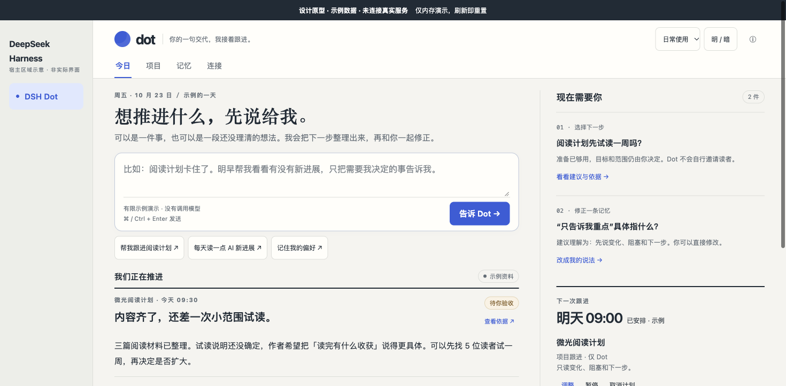
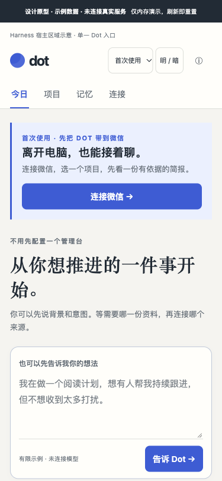
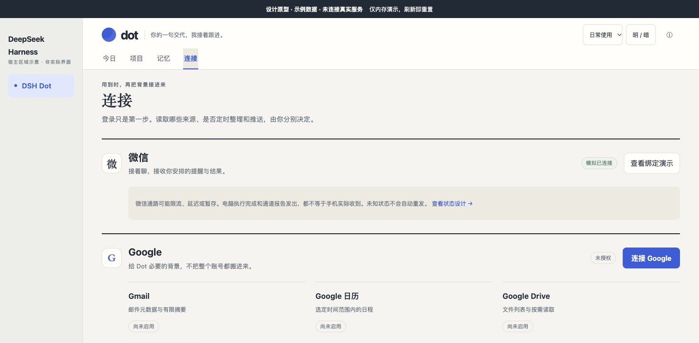

<p align="center">
  <picture>
    <source media="(prefers-color-scheme: dark)" srcset="docs/assets/preview/workbench-dark.png">
    
  </picture>
</p>

<h1 align="center">DSH Dot · 长在微信里的项目助理</h1>

<p align="center"><b>在微信或电脑交代一件事，Dot 把它接进对应项目、记住来龙去脉、按你定的时间跟进，再把执行结果带回原对话。</b></p>

<p align="center">
  
  
  
</p>

<p align="center"><sub>界面预览为设计稿，数据为示例。产品站与实机截图见 <a href="https://dot.finvo.ai/">dot.finvo.ai</a>。</sub></p>

作者：牛村木木山 · MIT · 社区开源项目，非 DeepSeek 官方产品。

---

## 为什么是 Dot，而不是又一个聊天框

聊天框只回答这一句。Dot 想接住的是接下来那一周：

- **事常常在微信里想起。** 你不在电脑前，但话要先记下来、交给对的项目。
- **项目跨会话，模型记不住。** 上次定的约束、否掉的方案、卡住的点，下次还得重新讲一遍。
- **交了事，结果要回到原对话。** 不是去另一个页面找，也不是"已发送，请自行确认"。

所以 Dot 只做一件事：**把一件事接进项目，记住它，跟进它，把结果带回来。** 其余连接和资料，都是可选增强。

## 三步上手

1. **装。** 打开 Harness 的「插件 → 添加插件」，在包名或地址里填 `@oxmumu3/dsh-project-companion`，安装后点「立即启用」。
2. **开。** 左侧出现「DSH Dot」。第一次打开不需要登录任何账号，先看一眼今日页。
3. **说。** 首页直接说一件正在推进的事，或先连微信，在手机上交办。

```bash
# 网页版也可以用命令行
dsh plugin --profile web add @oxmumu3/dsh-project-companion
```

桌面版只走插件页面安装；装完若宿主提示，再完整退出并重开。要求官方 Harness `0.2.x`、Node.js 22.13+。0.24 起不再随版本附带离线安装包，桌面版和网页版都走上面这条插件安装路径。

<p align="center">
  
</p>

<p align="center"><sub>第一次打开：不用填表，先说一件事。</sub></p>

## 第一次打开，先做一件有用的事

1. **连微信（可选）。** 首页直接显示二维码，本人扫码后从微信发一句「你好」。不连也能先在电脑聊。
2. **选工作区（可选）。** 点「保存并整理项目」，选一两个 Harness 已登记的目录；这是一次明确的有限读取，之后可随时增减，不会扫描没选的目录。
3. **继续事情。** 在首页输入目标，或从「项目」点进一个项目，在当前视野继续原生对话；草稿、附件和审批都保留。
4. **按需连资料。** Google、flomo、滴答都在「连接」里单独登录、单独启用；登录不会自动开始扫描。

<p align="center">
  
</p>

<p align="center"><sub>连接、启用、读取、持续跟进是四件事，分开授权。</sub></p>

## 能做什么

| 你想要的 | Dot 提供的 |
| --- | --- |
| 在微信里办事 | 明确交办、状态查询、把这一轮执行回复带回原对话；问「任务状态」不新建执行，说「停一下」停止当前任务、回复短码继续原任务；电脑端原生对话与 Harness 内浮层。详见[在微信继续当前任务](docs/mobile-control.md) |
| 记得住项目 | 从你选定的工作区与近期会话里识别持续目标，保存目标、约束、决策、阻塞和下一步；保留来源，建议由你保留或纠正 |
| 每天早上知道该干啥 | 有限读取 Gmail、主日历、Drive、flomo、滴答和已选项目，整理有来源的进展、风险与下一步 |
| 按节奏跟进 | 一次提醒、一次检查、周期跟进；无值得说的变化可以静默，结果不确定不盲重发 |
| 读你今天该看的 | AI 资讯日报：沿用你保存的关注点，从公开 RSS 里最多 3 篇重点 + 7 篇速览，附原文链接 |
| 自己先体检 | `health` 自检七行：助理、微信、资料来源、个人回顾、AI 资讯、投递、手机控制；只读本机，不发外部请求 |

## 可以直接这样说

- 「看看这个项目的进展、阻塞和下一步。」
- 「把这个任务交给 我的工作区：读取 README.md，用三句话说明用途，完成后把结果回给我。」
- 「两分钟后提醒我检查结果。」
- 「预览一份个人回顾，使用我在电脑启用的资料和已关注项目，不建立计划。」
- 「每天 09:00、每周一 09:00 做个人回顾，有风险或临期事项告诉我。」

## 它不会替你做的事

- **不替你扩大授权。** 账号连接、来源启用、一次读取、持续跟进分别确认；新增账号或工作区不会静默进入旧计划。
- **不把"发出去了"说成"你收到了"。** 通道接受、手机收到、本人验收是三种状态，Dot 分开说。
- **不在失败时反复重发。** 结果不确定只核对，不重放；被拒绝的消息留在原队列。
- **不把私人资料随手外发。** 本轮读过私人来源后，要把整理内容推到微信，需要你再确认一次。
- **不默认扫描或推送。** 安装不等于开启；工作区、个人回顾和日报都要你明确说一句。

## 微信配对的一句话说明

扫码确认时锁定扫码那个账号，之后不会因为"谁先发消息"改变归属；可选的白名单只是额外限制。身份缺失或冲突时暂停微信控制，提示你重新确认，不自动换绑、不静默补发。细节见[第一次使用](docs/first-use.md)与[安装说明](docs/install.md)。

## 版本与数据

- 当前版本 **`0.27.0`**：自检新增「手机控制」一行，看得出两边接没接上；`0.26.0` 并入手机端任务控制的 Dot 侧；`0.25.0` 补上滴答账户级只读搜索。
- 兼容官方 Harness `0.2.0-rc.2`、`0.2.1-rc.2` 至 `rc.5`、`0.2.2-rc.1`；清单在 [compatibility.json](compatibility.json)。
- 数据留在本机 Harness profile 内，不经过第三方服务器；微信组件内置部分保留上游 MIT 许可，见 [THIRD_PARTY_NOTICES.md](THIRD_PARTY_NOTICES.md)。
- 已知边界（Google 数据权限审核、flomo MAX、主动关注与手机收件的验收状态）统一写在[验证记录](docs/verification.md)，本页不重复。

## 常见问题

**要装两个插件吗？**
不用。微信组件已内置在同一个标准插件包里；已经有兼容的外部微信组件时沿用原来的，不会重置绑定。

**不连微信能用吗？**
能。电脑端对话、项目、记忆、回顾都可用；微信只是"人不在电脑前"时的入口。

**和 Harness 自带的会话有什么区别？**
Harness 管一次对话；Dot 管跨会话的项目：它记得目标、约束、决策和下一步，并在你定的时间回来看一眼。

**为什么有时微信没收到？**
先看「连接」页的通道状态和自检结果。发送被拒时 Dot 会说明，不会假装已送达，也不会替你重发。

## 文档与开发

- [安装说明](docs/install.md) · [第一次使用](docs/first-use.md) · [快速开始](docs/quickstart.md)
- [验证记录](docs/verification.md) · [对照与复用](docs/comparison.md) · [版本记录](CHANGELOG.md)
- [单插件分发边界](docs/single-plugin.md) · [逻辑项目与工作区](docs/logical-projects.md) · [个人回顾](docs/personal-review.md)

```bash
npm test          # 源码全量回归
npm run demo      # 离线合成演示（不连模型、微信或云端）
npm run verify    # 发布前自检
```

## 设计思考

[《DeepSeek Harness 要走向极客玩具还是大众普惠？》](https://mp.weixin.qq.com/s/RIAYNqo8OsUVx2JpR8MPyA)

## 许可

MIT。内置微信组件保留上游 MIT 许可与版权声明，见 [THIRD_PARTY_NOTICES.md](THIRD_PARTY_NOTICES.md) 与 [bridge-maintenance](bridge-maintenance/)。

---

<p align="center"><sub>如果 Dot 帮你少翻了一次聊天记录，欢迎点个 Star；用得不对劲，开 Issue 告诉我。</sub></p>
